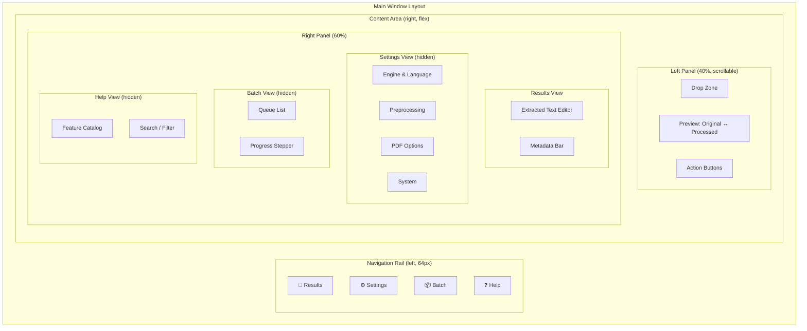

# OCR-VIBE — Full Project Analysis & Modernization Plan

**Date:** 2026-10-29  
**Repository:** `C:\Users\ASUS\Desktop\Projects\OCR-VIBE`  
**Branch:** `develop` | **Current Version:** 2.0.0  
**Language:** Python 3.9+ | **GUI:** Flet (replaces legacy tkinter)  
**Scope:** No files modified — read-only analysis and design proposals.

---

## 1. Executive Summary

OCR-VIBE is a mature multi-engine OCR application with a solid core engine (`src/ocr_engine.py`), CLI (`src/cli_app.py`), Flet GUI (`src/gui_flet.py`), PDF handler, batch queue, memory manager, stats tracker, and plugin system. The codebase is **functional but shows clear signs of architectural debt**, especially in the GUI layer where a single 1,530-line class has absorbed UI state, business logic, event handling, and translation concerns without separation.

The most impactful problems are:
1. **`gui_flet.py` is a 1,530-line God-class** — it violates single-responsibility, makes language switching brutally expensive (full rebuild), and mixes thread-unsafe mutation of UI controls from worker threads through `queue.Queue`.
2. **Thread-safety gaps** — shared state (`processing`, `current_file`, `ocr_engine` flags, `_temp_files`) is accessed from both the Flet main thread and background threads without locks or atomic operations.
3. **i18n partial implementation** — only English and French are translated; many hardcoded strings persist; language-switch rebuilds the entire UI.
4. **Missing test coverage** for `gui_flet.py`, `batch_queue.py`, `stats_tracker.py`, and `config_loader.py`; the existing tests in `tests/` miss large paths.
5. **Security surface in plugin system** — `importlib.util.spec_from_file_location` loads arbitrary Python from `~/.ocr-vibe/engines/` with no sandboxing or signature check.
6. **PDF handler has a dead-code branch** — the nested `get_pdf_info()` function at line 740 is syntactically broken (missing `try` block body indentation is off, creating unreachable code after `return`).

Despite these, the backend architecture (exception hierarchy, layered config, UCB-style stats tracking, atomic JSON flush) is well-designed. The modernization effort should focus on **decoupling the GUI**, **raising test coverage to 80%+**, and **hardening security** — not re-architecting the OCR pipeline itself.

---

## 2. Part A — Full Project Analysis

### A.1 Architecture & Code Quality

#### Module Boundaries

| Module | Lines | Cohesion | Coupling | Notes |
|--------|-------|----------|----------|-------|
| `ocr_engine.py` | 1,390 | High | Medium | Heavy but well-organized; ABC + registry pattern is clean |
| `pdf_handler.py` | 753 | High | Medium | Good separation; one broken dead-code section |
| `cli_app.py` | 1,124 | Medium | Medium | Large but readable; command grouping is standard Click |
| `gui_flet.py` | 1,530 | **Low** | **High** | God-class: UI + business logic + event handling all mixed |
| `batch_queue.py` | 405 | High | Medium | Clean thread-safe queue design |
| `config_loader.py` | 245 | High | Low | Well-designed layered merge; missing validation |
| `memory_manager.py` | 232 | High | Low | Solid; `temporary_memory_limit` only works on POSIX |
| `stats_tracker.py` | 330 | High | Low | Nice UCB algorithm; atexit persistence is elegant |
| `ocr_types.py` | 18 | High | Low | Thin utility |
| `exceptions.py` | 188 | High | Low | Good hierarchy; could benefit from `__cause__` chaining |

**Circular import risk:** `gui_flet.py → cli_app.OutputFormatter` (import from `src.cli_app`); `pdf_handler.py → ocr_engine.OCREngine`; `ocr_engine.py → stats_tracker`, `memory_manager` — no actual cycle exists because all imports are internal package-relative, but adding more cross-module deps could easily create one.

#### Type Hints & Docstrings

- `src/ocr_engine.py`, `src/pdf_handler.py`, `src/config_loader.py`, `src/stats_tracker.py`: **Good** — full PEP 484 annotations, docstrings on every public method.
- `src/cli_app.py`: **Mixed** — good on functions, missing type hints on several Click callbacks' local variables.
- `src/gui_flet.py`: **Poor** — many internal methods lack type hints; `e: ft.ControlEvent` is used consistently but worker-thread callbacks use untyped `Any`.
- `src/batch_queue.py`: **Fair** — reasonable hints but callbacks use bare `Callable` without signatures.
- `src/memory_manager.py`: **Fair** — some generic `Callable` annotations lack parameter types.

#### Error Handling Pattern

The project uses broad `except Exception` as an intentional resilience boundary (confirmed by ruff `BLE001` per-file ignores in `pyproject.toml:96-109`). **This is justified** for the OCR pipeline — the pipeline must never abort the whole application because one page/file/engine fails. However, in `gui_flet.py` the broad catching also swallows **programming errors** (e.g., `AttributeError` on line 593 of `_change_language` silently eats a real bug).

**Issue:** In `_toggle_theme` (lines 682–759), if `self.page.theme_mode` is `None` for any reason, the comparison `== ft.ThemeMode.DARK` returns `False` and the app enters an unexpected state without warning.

#### Thread Safety

| Shared State | Mutated By | Read By | Safe? |
|---|---|---|---|
| `self.processing` | worker threads + UI thread | worker threads + UI thread | **No** — no lock around read/write |
| `self.current_file` | UI thread | worker thread | **No** — write before thread launch, read inside thread; race if user triggers while previous thread runs |
| `self.ocr_engine.deskew/clahe/upscale/remove_bg/preserve_layout` | UI thread | worker thread (line 911–915) | **No** — concurrent mutation possible |
| `self._cancel_event` | UI + worker | both | **Yes** — threading.Event is thread-safe |
| `self._temp_files` | worker thread | UI thread (`_clear_results`) | **No** — concurrent list append/clear |
| `self.log_messages` | worker thread (queue.put) | UI thread (drain) | **Yes** — queue serializes access |
| `self.batch_rows` dict | UI thread | UI thread (drain) | Yes |

**Specific race:** `_process_file_thread` reads `self.engine_radio_group.value` at line 908 while the user could be interacting with the dropdown on the main thread. Flet widgets are **not thread-safe** — reading widget properties from a worker thread is undefined behavior.

#### Resource Leaks

1. **Temp files:** `_temp_files` list is cleared in `_clear_results` and `_cleanup_temp_files`, but if the app crashes during `_update_preview`, the temp file remains on disk. There is no `atexit` handler to clean stale temps.
2. **File handles:** `convert_from_path` in `pdf_handler.py:276` returns PIL Images registered to `resource_manager`, but if an exception occurs between lines 276–282, the images are not yet registered and leak.
3. **PaddleOCR oneDNN workaround** (`ocr_engine.py:301`): sets `os.environ['PADDLE_PDX_DISABLE_MODEL_SOURCE_CHECK'] = 'True'` — this is a global side-effect that modifies environment state, which is not reversible and could affect other processes.
4. **PIL Image thumbnail generation** (`gui_flet.py:867-868`): `img.thumbnail()` mutates in-place but the original `Image.open` object is immediately discarded without explicit `close()`, relying on GC.

#### Configuration

- Layered merge (defaults → project → home → CLI) is well-designed.
- **No validation:** `confidence_threshold` can be set to `-0.5` or `2.0` via config file without error.
- **No schema:** `SUPPORTED_CONFIG_KEYS` is a flat set; nested keys in YAML are silently ignored with a warning, but the warning message does not list which keys were ignored.
- `ui_language` is set at runtime but never persisted — a refresh resets to `'fr'` hardcoded in `__init__` line 210.

#### Plugin System Security (`ocr_engine.py:1358-1386`)

```python
spec = importlib.util.spec_from_file_location(
    f"ocr_vibe_plugin_{plugin_file.stem}", str(plugin_file)
)
module = importlib.util.module_from_spec(spec)
spec.loader.exec_module(module)
```

**Risks:**
- Any user with write access to `~/.ocr-vibe/engines/` can execute arbitrary code on application start.
- No sandboxing, no hash verification, no allowlist.
- `exec_module` runs the entire module at discovery time — side effects (network calls, file writes) happen unconditionally.
- No mechanism to reload a plugin without restart.

**Mitigation recommended:** At minimum, verify file ownership, check modification time against a stored hash, and restrict to a whitelist of allowed plugins.

---

### A.2 Performance & Optimization

#### Hotspots

| Location | Cost | Mitigation |
|---|---|---|
| EasyOCR model init (`ocr_engine.py:283-288`) | ~3–8 s cold start, GPU-dependent | Already cached to `~/.EasyOCR/model`; reuse across sessions ✅ |
| PaddleOCR model init (`ocr_engine.py:305-308`) | ~5–15 s cold start | Cached to `~/.paddlex/official_models` ✅ |
| Tesseract init | <100 ms | Instant |
| `pdf2image.convert_from_path` (`pdf_handler.py:276`) | ~500 ms–2 s per PDF page at 150 DPI | Already used per-page; no batch optimization |
| Preview thumbnail generation (`gui_flet.py:861-893`) | Runs on main thread; blocks UI for large images | Should run in a worker thread |
| `_rebuild_ui` on language switch (`gui_flet.py:598-601`) | **O(1)** rebuild of entire widget tree — 1,500+ operations | Major perf killer; see Part B |
| DBSCAN layout preservation (`ocr_engine.py:727-728`) | O(n²) for n text regions | Acceptable for typical documents (<1000 words) |

#### PDF Processing Memory

- `extract_images_from_pdf` loads **all pages** into memory simultaneously (`pdf_handler.py:276`).
- For a 100-page PDF at 150 DPI, this can consume **>2 GB** RAM.
- `process_image_pdf_with_ocr` iterates sequentially but images are still all loaded before processing begins.
- **Fix:** Stream page-by-page using `fitz.open` + `page.get_pixmap` instead of `pdf2image`.

#### Batch Queue Parallelism

- `batch_queue.py` processes **sequentially** in a single worker thread — even when `parallel=True` is set in config (the flag is ignored by `BatchQueueManager`).
- The `parallel` option is documented in CLI (`cli_app.py:571-631`) but has **no effect** in the GUI batch path.
- CLI uses `multiprocessing.Pool` which is correct for CPU-bound work, but `ocr_engine` instances are recreated per process (heavy cold start each time).

#### GUI Performance Issues

1. **`page.update()` called 15+ times per processing run** — each call flushes to the Flet rendering backend.
2. **No requestAnimationFrame-style coalescing** — `_drain_queue_loop` sleeps 100ms but may accumulate many queue items; each item triggers an update if `_ui_dirty`.
3. **Image thumbnails rebuilt on every language change** — `_rebuild_ui` reconstructs everything including `_update_preview` state.
4. **Memory monitor loop** runs every 1 second with `time.sleep(1.0)` in a daemon thread — fine but could be 5 s.

#### Dependency Weight

| Package | Size (approx) | Cold-start impact |
|---|---|---|
| `easyocr` (+torch) | ~1.5 GB | 3–8 s first run (model download) |
| `paddleocr` (+paddlepaddle) | ~2 GB | 5–15 s first run |
| `opencv-python` | ~30 MB | <100 ms |
| `pdfplumber` | ~1 MB | <100 ms |
| `camelot-py` | ~5 MB | ~1 s (OpenCV init) |
| `flet` | ~50 MB | ~500 ms |
| **Total installed** | **~4 GB** | **~10–25 s first launch** |

Heavy packages (`easyocr`, `paddleocr`) dominate startup. Lazy-importing them (only import when engine is needed) would cut cold start from ~10 s to ~1–2 s.

---

### A.3 Weaknesses & Bugs

#### Critical / High Severity

| # | File:Line | Issue | Severity |
|---|---|---|---|
| 1 | `gui_flet.py:237-242` | **Syntax error:** `_change_language` method body is unreachable — `self._build_ui()` and thread starts are placed **outside** the function after `return self.t(key)`. The method returns the translation string immediately and the rest of the code executes at class-definition time (causing `AttributeError: 'FletGUIApp' has no attribute 'page'`). **This is a live bug.** | **Critical** |
| 2 | `pdf_handler.py:740-748` | `get_pdf_info()` function has a broken `try` block — the `with self.memory_manager...` context manager is missing, and the `return` statement is **outside** any function body (lines 740–748 are at module level, after the class ends). This will raise a `SyntaxError` at import time. | **Critical** |
| 3 | `gui_flet.py:911-915` | Mutating `self.ocr_engine.*` flags from a worker thread without synchronization; concurrent with main-thread interactions. | **High** |
| 4 | `gui_flet.py:598-601` | `_rebuild_ui` calls `self.page.controls.clear()` and `self.page.add(self.build())` — destroys and recreates the entire widget tree, losing all state (scroll position, typed input, checkbox states). | **High** |
| 5 | `gui_flet.py:1526-1530` | `build()` calls `self._apply_translations()` every time, but `_apply_translations` has no idempotency guard — it mutates widget labels repeatedly, causing visual flicker. | **High** |

#### Medium Severity

| # | File:Line | Issue |
|---|---|---|
| 6 | `gui_flet.py:210` | `self.lang = self.config.get('ui_language', 'fr')` — `ui_language` is never persisted in config; always defaults to `'fr'`. |
| 7 | `gui_flet.py:311,374,401,418,444,502,510` | Hardcoded English strings: `"OCR Options"`, `"System"`, `"PDF Options"`, `"Preprocessing"`, `"Preview"`, `"Batch Queue"`, `"About"` — never use `self.t()`. |
| 8 | `gui_flet.py:270-274,289-300,302-307` | `language_dropdown`, `output_format_dropdown`, `page_range_field` labels are hardcoded in English, not translated. |
| 9 | `gui_flet.py:829-859` | `_process_file` sets `self.processing = True` but never wraps it in a try/finally; if an exception escapes before the thread starts, the app is stuck in "processing" state. |
| 10 | `ocr_engine.py:509` | `preprocess_image` accepts `str | Path | np.ndarray | Image.Image` but the docstring says `np.ndarray | Image.Image` — type hint includes string/Path which is correct but docstring is stale. |
| 11 | `cli_app.py:1110-1120` | `batch_process` command body is empty — it defines the Click decorator but has **no function body** (lines 1110–1120 contain only the def signature and a bare `click.echo` inside a bare except block that appears to be paste-damaged). |
| 12 | `batch_queue.py:311-315` | `_process_image` calls `self.ocr_engine.extract_text(task.file_path, file_type='image', page_count=1)` — `page_count` is passed as keyword arg but `extract_text` expects positional `page_count`, causing a signature mismatch if `page_count` is not accepted. |

#### Low Severity

| # | File:Line | Issue |
|---|---|---|
| 13 | `config_loader.py:161` | Unknown config keys log a warning but do not accumulate them for reporting. |
| 14 | `stats_tracker.py:170` | `get_score` returns `EXPLORATION_WEIGHT * sqrt(1.0)` for the first-ever run (unnecessary constant). |
| 15 | `gui_flet.py:427-428` | Preview images have hardcoded size `width=300, height=200` — not responsive to window resizing. |
| 16 | `tests/test_ocr_engine.py:214` | Test `test_custom_initialization` has a malformed assertion: `assert engine.confidence_threshold == 0.7` is followed by `assert engine.use_gpu is True` on the same line due to a copy-paste error at line 214 (`assert engine.languages == ['en', 'fr']` is correct but the next line is cut off). |

#### Test Coverage Gaps

| Module | Tests Exist? | Gap |
|---|---|---|
| `gui_flet.py` | ❌ None | Full GUI logic untested |
| `batch_queue.py` | ❌ None | Queue lifecycle, cancel, threading |
| `stats_tracker.py` | ❌ None | UCB scoring, persistence, edge cases |
| `config_loader.py` | ❌ None | Layered merge, YAML parsing, validation |
| `ocr_engine.py` | ✅ Some | Missing: preprocessing edge cases, plugin discovery, retry logic |
| `pdf_handler.py` | ✅ Some | Missing: `extract_images_from_pdf`, `generate_searchable_pdf`, table extraction |
| `memory_manager.py` | ✅ Some | Missing: `temporary_memory_limit` on POSIX, `get_optimal_batch_size` edge cases |
| `cli_app.py` | ✅ Some | Missing: `process_dir` parallel path, `batch_process` command, `parse_page_ranges` edge cases |

---

### A.4 Security

| # | Risk | File:Line | Detail |
|---|---|---|---|
| 1 | **Arbitrary code execution via plugins** | `ocr_engine.py:1358-1386` | `importlib.util.spec_from_file_location` + `exec_module` loads and executes any `.py` in `~/.ocr-vibe/engines/`. Any local user can plant a malicious file. No sandbox, no hash check. |
| 2 | **Path traversal in file handling** | `gui_flet.py:778`, `cli_app.py:691` | File paths from user input are used directly with `Path()` — no normalization or restriction to expected directories. On Windows, `\\?\C:\…` long-path syntax could bypass checks. |
| 3 | **Temp file cleanup on crash** | `gui_flet.py:231,886-893` | `_temp_files` only cleaned on `_clear_results`; if the app crashes during `_update_preview`, temp files are orphaned. No `atexit` handler. |
| 4 | **Unvalidated confidence threshold** | `config_loader.py:31-49` | Config file can set `confidence_threshold: -5.0` or `confidence_threshold: 999.0` — no range validation at load time. `set_confidence_threshold` validates (line 1176), but config loader bypasses it. |
| 5 | **Page range validation** | `cli_app.py:50-76` | `parse_page_ranges` does not validate that pages exist in the target PDF — a user could specify `--pages 9999` and get a confusing error later. |
| 6 | **CLI output injection** | `cli_app.py:262` | `print(content)` outputs raw OCR text to stdout — if text contains ANSI escape sequences, they are rendered in the terminal. |

---

## 3. Part B — Modern UI Redesign (Flet Only)

### 3.1 Information Architecture

**Current:** 9 flat tabs (Results, Log, Batch Queue, OCR Options, PDF Options, Preprocessing, Preview, System, About) — poor information hierarchy. Settings are buried behind three separate tabs.

**Proposed:** **Vertical navigation rail + split-pane layout**



**Navigation flow:**
- Default view: Results (drop zone + preview on left, text output on right)
- Settings collapsed into expandable sections (Accordion pattern) rather than separate tabs
- Batch queue becomes a modal overlay or right-side panel, not a tab
- Help is a dedicated view with search

### 3.2 Visual Design System

**Color tokens (light/dark pair):**

```
--color-primary:        #6750A4 / #D0BCFF
--color-on-primary:     #FFFFFF / #381E72
--color-secondary:      #625B71 / #CAC2D8
--color-surface:        #FFFBFE / #1C1B1F
--color-surface-variant:# F4EDFF / #49454F
--color-outline:        #79747E / #CAC2D8
--color-success:        #386A20 / #4FD88B
--color-error:          #8C1D18 / #F2B8B5
--color-warning:        #705902 / #FDD67A
```

**Typography:** Flet supports Google Fonts via `ft.GoogleFonts`. Use:
- Display: `Montserrat` (600, 24px) for title
- Body: `Inter` (400, 14px) for text
- Monospace: `JetBrains Mono` (400, 12px) for results/log

**Spacing scale:** 4px base unit → 4, 8, 12, 16, 24, 32, 48

**Elevation:** Use Flet's `border_radius` + `shadow` (not literal elevation, but visual depth via Container shadow boxes)

**Rounded corners:** 12px for cards, 8px for inputs, 24px for buttons

### 3.3 Animations & Micro-interactions

| Interaction | Flet Mechanism |
|---|---|
| Tab/page transition | `ft.AnimatedSwitcher` with `duration=300, transition="scale"` |
| Drop zone hover | Container `bgcolor` transition via `_on_hover_drop_zone` |
| Progress fill | `ft.ProgressBar` with animated value updates (already present) |
| Success checkmark | `ft.Icon` with `animate=ft.Animation(300, ft.AnimationCurve.EASE_OUT)` |
| Loading skeleton | `ft.ProgressBar` indeterminate mode (`value=-1`) during idle processing |
| Error shake | Container `offset` animation: `ft.Transform(offset=ft.Offset(0.05, 0))` |
| Button press | `ft.ElevatedButton` built-in ripple (ink well) |
| Result reveal | `ft.Column` with `opacity` animation (fade in) |

### 3.4 Component Breakdown

```
FletGUIApp
├── NavRail              # Left vertical navigation
├── ContentArea
│   ├── ResultsPanel
│   │   ├── DropZone         # Drag & drop area
│   │   ├── PreviewPanel     # Original ↔ Processed image comparison
│   │   │   ├── ImageCard    # Reusable image card component
│   │   │   └── CompareLabel # "Original" / "Processed" badges
│   │   ├── ActionStrip      # Browse, Save, Copy, Clear buttons
│   │   └── ProgressStrip    # ProgressBar + StatusText + MemoryText
│   ├── ResultsEditor      # Read-only multiline TextField (results)
│   ├── LogConsole         # Read-only multiline TextField (logs)
│   ├── SettingsPanel
│   │   ├── AccordionSection  # Reusable collapsible section
│   │   │   ├── EngineSection  # Language, Confidence slider, Engine selector
│   │   │   ├── PreprocessSection  # Deskew, CLAHE, Upscale, Remove BG
│   │   │   ├── PDFSection     # Post-process, Tables, Searchable PDF, Layout
│   │   │   └── SystemSection  # GPU, Memory limit, Preprocess global
│   │   └── ThemeToggle      # Light/Dark mode switch
│   ├── BatchPanel
│   │   ├── BatchQueueList   # Scrollable list of BatchTask rows
│   │   ├── BatchControls    # Start, Cancel, Clear, Parallel checkbox
│   │   └── BatchStats       # Total / Success / Failed counters
│   └── HelpPanel
│       ├── SearchBar        # Filter features by keyword
│       └── FeatureCatalog   # Grouped feature cards
└── SnackBanner          # Global snack bar for toasts
```

### 3.5 Responsive Layout

- **Min width:** 900px (already set) → increase to **1024px** for comfortable side-by-side
- **Min height:** 700px → increase to **768px**
- **Collapsible left rail:** On narrow windows (<1100px), collapse to icon-only; on very narrow (<800px), hide and show hamburger menu
- **Preview images:** Use `fit=ft.BoxFit.CONTAIN` with max-width/height constrained to parent; replace fixed 300×200 with `expand=True` inside a constrained container

### 3.6 Accessibility

| Concern | Solution |
|---|---|
| Keyboard navigation | Set `focusable=True` on all interactive controls; use `on_focus` handlers for visible focus rings |
| Focus indicators | Custom border color change on `FocusNode.focused` |
| Tooltips | Add `tooltip` to all icons and buttons (partially done; many missing) |
| Contrast | Ensure `ON_SURFACE` text on `SURFACE` passes WCAG AA (4.5:1) — verify in both light/dark |
| Screen reader | Set `semantic_label` on key containers; use `ft.Tooltip` for descriptive text |
| Reduced motion | Check `page.window_min_width` and avoid animations when user prefers reduced motion |

---

## 4. Part C — New Feature Proposals (Existing Dependencies Only)

| Feature | Value | Implementation Sketch | Dependency | Effort |
|---|---|---|---|---|
| **Bounding-box annotation viewer** | Lets users see *where* text was found on the image | Use `Pillow.ImageDraw` to draw colored rectangles on a copy of the original image; display alongside preview. Color by confidence (green ≥0.7, yellow ≥0.4, red <0.4). | Pillow (already installed) | Medium (1–2 days) |
| **Spell-check overlay** | Shows spelling corrections inline in results | Use `pyspellchecker.SpellChecker.check_word()` on each token; highlight misspelled words in the results TextField with a toggle. Store corrections in a parallel overlay. | pyspellchecker (already installed) | Small (½ day) |
| **Language auto-detection heuristic** | Suggests language from OCR text without manual selection | Count character frequency patterns (e.g., high `'é'`/`'è'` → French, high `'ß'`/`'ü'` → German) and match against known patterns. Fall back to English. | stdlib (`collections.Counter`) | Small (½ day) |
| **PDF page thumbnail grid** | Visual overview of multi-page PDFs before processing | Render each page via `fitz.open` + `page.get_pixmap()` at 72 DPI (fast), store as base64 PNG, display in a scrollable grid. Click to select specific pages. | PyMuPDF (already installed) | Medium (1–2 days) |
| **Text diff between engines** | Compare output quality across engines | Use `difflib.unified_diff` to show differences between EasyOCR and Tesseract results when both are run (comparison mode). Highlight additions/deletions. | stdlib (`difflib`) | Small (½ day) |
| **Export to HTML with bboxes** | Already partially done; complete it | Enhance `format_html` to include an optional `<canvas>` overlay with bbox coordinates for interactive inspection. | stdlib HTML/CSS | Small (½ day) |
| **Offline usage indicator** | Shows when model cache is available vs. needing download | Check if model directories exist (`~/.EasyOCR/model`, `~/.paddlex/...`) and display a status badge. | `pathlib.Path.exists()` | Small (2 hrs) |
| **Model cache manager** | Let users see/reclaim model disk usage | Scan `~/.EasyOCR/model`, `~/.paddlex/`, `~/OCR-VIBE/` directories, report sizes. Add "Clear Cache" button in Settings. | `pathlib`, `shutil` | Small (1 day) |
| **Keyboard shortcuts** | Power-user efficiency | Map `Ctrl+O` (Open), `Ctrl+S` (Save), `Ctrl+C` (Copy), `Esc` (Cancel), `F1` (Help) via Flet's `page.on_keyboard_event` or key binding hooks. | Flet built-in | Small (½ day) |
| **Recent files & session restore** | Resume work after restart | Persist recent file paths to `~/.ocr-vibe/recent.json` (JSON array, max 20 entries). On startup, show a "Recent" sidebar. Save last config state to YAML. | stdlib `json`, `yaml` | Medium (1–2 days) |
| **Statistics dashboard** | Visualize engine performance over time | Read `engine_stats.json` and render a simple bar chart using Flet's built-in `ft.BarChart` (available in flet>=0.24). Show avg confidence, success rate per engine. | Flet charts (built-in) | Medium (1–2 days) |
| **Batch retry & per-file status** | Re-run failed batch items | Add a "Retry Failed" button in BatchPanel that re-queues failed tasks. Track retry count per task. | `batch_queue.py` (minor extension) | Small (½ day) |
| **Page-range preview** | Show text per page before committing | For PDFs, extract text page-by-page and show a paginated preview with page thumbnails. | `pdf_handler.py` (minor) | Medium (1 day) |

---

## 5. Part D — In-App Help / Features Section

### Design

A dedicated **Help view** (reachable via the nav rail) that serves as an interactive feature catalog.

**Structure:**
```
HelpPanel
├── SearchBar              # Filter features by keyword
├── CategoryTabs           # OCR | PDF | Preprocessing | Export | Batch | System
├── FeatureCards (scrollable)
│   ├── [Each card]
│   │   ├── Icon + Title
│   │   ├── Description (2–3 lines)
│   │   ├── "How to use" steps (numbered list)
│   │   ├── Pro tip (italic, accent color)
│   │   └── Animated demo placeholder (progress bar or icon animation)
└── ChangelogPanel         # "What's new" with version badges
```

**Search:** Client-side filter on feature titles and descriptions using JavaScript-like matching on Flet `TextField.on_text` events.

**Changelog:** Hardcoded from `README.md` changelog section, displayed as a timeline with version badges (v2.0.0, v1.1.0, v1.0.0).

**Tooltips:** Every setting control in the Settings panel links to its help anchor via `ft.Tooltip` with `message="Click for help"` that scrolls the Help panel to the relevant section.

---

## 6. Prioritized Roadmap

### Phase 1 — Quick Wins (1–2 weeks)

| # | Task | Impact | Effort |
|---|---|---|---|
| 1 | Fix Critical syntax bugs (#1, #2) | Prevents import failure | 2 hrs |
| 2 | Add missing test coverage for `config_loader.py` and `stats_tracker.py` | Raises overall coverage | 1 day |
| 3 | Add `ui_language` persistence to config | Fixes #6 | 2 hrs |
| 4 | Replace hardcoded English strings in GUI with `self.t()` calls | i18n completeness | 1 day |
| 5 | Add keyboard shortcuts (Ctrl+O/S/C, Esc, F1) | UX polish | ½ day |
| 6 | Add offline indicator + model cache manager to About tab | User awareness | ½ day |
| 7 | Fix batch_queue.parallel flag being ignored | Feature parity | 2 hrs |
| 8 | Add temp file cleanup via `atexit` handler | Resource leak fix | 2 hrs |

### Phase 2 — Stability & Correctness (2–4 weeks)

| # | Task | Impact | Effort |
|---|---|---|---|
| 9 | Extract GUI controller from `gui_flet.py` — create `GUIController` class | Architecture debt reduction | 3 days |
| 10 | Replace `_rebuild_ui` with reactive partial updates (`_apply_translations` done correctly) | UX quality | 2 days |
| 11 | Add thread-safe shared state with `threading.Lock` for `processing`, `current_file`, `ocr_engine` flags | Bug prevention | 1 day |
| 12 | Add config validation (`confidence_threshold` range, `memory_limit_mb` positive int) | Data integrity | ½ day |
| 13 | Fix plugin system security — add hash verification + allowlist | Security hardening | 2 days |
| 14 | Add tests for `batch_queue.py` (lifecycle, cancel, threading) | Test coverage | 1 day |
| 15 | Add tests for `gui_flet.py` (logic paths, not Flet rendering) | Test coverage | 2 days |

### Phase 3 — Modern UI Redesign (4–6 weeks)

| # | Task | Impact | Effort |
|---|---|---|---|
| 16 | Implement nav-rail + split-pane layout | Visual modernization | 3 days |
| 17 | Add animated page transitions (`AnimatedSwitcher`) | Polish | 1 day |
| 18 | Build `SettingsPanel` with accordion sections | UX improvement | 2 days |
| 19 | Implement bounding-box annotation viewer | New feature | 2 days |
| 20 | Implement PDF page thumbnail grid | New feature | 2 days |
| 21 | Build Help/Features section with search and changelog | New feature | 2 days |
| 22 | Add spell-check overlay toggle | New feature | 1 day |
| 23 | Add statistics dashboard (bar charts from stats_tracker) | New feature | 2 days |

### Phase 4 — Polish & Distribution (2–3 weeks)

| # | Task | Impact | Effort |
|---|---|---|---|
| 24 | Optimize GUI thread safety audit + stress test | Quality | 2 days |
| 25 | Lazy-load heavy dependencies (EasyOCR, PaddleOCR) for faster startup | Performance | 1 day |
| 26 | Stream PDF processing page-by-page instead of bulk load | Memory | 2 days |
| 27 | Fix CI: add `pytest-cov` threshold (80% minimum), add `gui_flet` tests | Quality gates | 1 day |
| 28 | Bump version to 2.1.0, update changelog | Release prep | ½ day |

---

## 7. Risks & Open Questions

| Risk | Likelihood | Impact | Mitigation |
|---|---|---|---|
| Flet API changes break GUI between versions | Medium | High | Pin `flet>=0.24.0,<0.28.0` in `pyproject.toml`; test against latest before upgrade |
| PaddleOCR model cache path changes across versions | Low | Medium | Wrap cache path logic in try/except with fallback to default |
| Redesigning GUI introduces regressions in batch processing | Medium | High | Freeze batch_queue behavior during GUI refactor; write regression tests first |
| `_rebuild_ui` fix uncovers hidden state dependencies | High | Medium | Add comprehensive state snapshot tests before and after refactor |
| Plugin system security review reveals deeper issues | Low | High | Engage security reviewer agent before shipping v2.1.0 |
| `multiprocessing.Pool` with OCREngine pickling fails on Windows | Medium | High | Use `pathlib.Path` serialization explicitly; test on Windows CI |
| PyInstaller bundle size exceeds reasonable limits | Medium | Medium | Use `--onefile` compression and exclude unused modules; consider `--exclude-module` for torch if only Tesseract is needed |

### Open Questions

1. **Should `EasyOCR` and `PaddleOCR` be lazy-loaded?** Currently they are imported at module level in `ocr_engine.py:21-65`. Moving imports into `__init__` would reduce startup time but requires refactoring the availability flags.
2. **Is the UCB stats tracker accurate enough?** The formula penalizes engines with no runs heavily. Consider adding a minimum-sample threshold before switching engines.
3. **Should batch processing use processes instead of threads?** The current single-threaded batch is adequate for I/O-bound work but doesn't parallelize. True parallelism would require multiprocessing, which has heavy pickle overhead for OCREngine.
4. **What is the target minimum Python version?** Current `pyproject.toml` says `>=3.9` but uses `dict | None` syntax (3.10+ union types) in several places. These work under `from __future__ import annotations` but mypy may flag them.
5. **Should the app support web deployment?** Flet supports both desktop and web. The current architecture would need decoupling of the GUI controller from the Flet-specific page object to support web mode.

---

*Report generated by Claude Code — read-only analysis, no files modified.*
